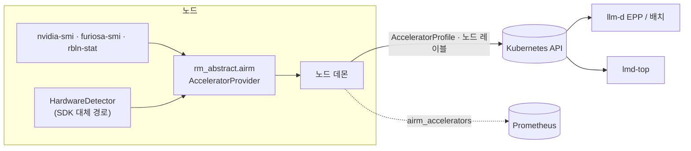

<div align="center">

<h1>rm-accel</h1>

<h3>이종 AI 인프라를 위한 가속기 추상화</h3>

<p>
  <a href="README.md">English</a> · <strong>한국어</strong>
</p>

<p>
  <a href="https://github.com/ai-computing/rm-accel/actions/workflows/ci.yml"></a>
  <a href="https://github.com/ai-computing/ai-rm"></a>
  <a href="https://github.com/ai-computing/rm-core/blob/v0.1.1/PROTOCOL.md"></a>
  <a href="https://github.com/ai-computing/rm-accel/releases/tag/v0.4.1"></a>
  <a href="deploy/helm/rm-abstract-node"></a>
  <a href="https://www.python.org/downloads/"></a>
  <a href="LICENSE"></a>
</p>

<p>
  <a href="#-빠른-시작"><b>빠른 시작</b></a> ·
  <a href="#-ai-rm-연동"><b>ai-rm 연동</b></a> ·
  <a href="#-vllm-호환-api"><b>vLLM 호환 API</b></a> ·
  <a href="#-구조"><b>구조</b></a> ·
  <a href="#-문서"><b>문서</b></a>
</p>

</div>

---

이전 이름은 `rm_abstract_layer`입니다. Python 패키지 이름은 `rm_abstract` 그대로이고, 노드 데몬은 기존 대시보드와
질의가 계속 동작하도록 지표에 `component="rm_abstract_layer"` 태그를 그대로 붙입니다.

**rm-accel**는 [ai-rm](https://github.com/ai-computing/ai-rm)의 **L1 가속기 추상화** 구성요소입니다. 각 노드의
GPU와 NPU(FuriosaAI RNGD, Rebellions ATOM)를 탐지해 [rm-core](https://github.com/ai-computing/rm-core)의
`Accelerator` 모델로 표현하고, Kubernetes에 `AcceleratorProfile` 객체와 노드 레이블로 게시합니다. 배치(llm-d EPP)와
관측(lmd-top)이 이 정보를 읽습니다.

같은 코드를 GPU나 CPU에서 실행하고 서빙 엔진(vLLM, Triton, TorchServe)을 바꿔 쓸 수 있는 **vLLM 호환 Python API**도
제공합니다.

성숙도: 프로토타입(Alpha). 현재 릴리스 v0.4.1, Helm chart 0.4.2 — [변경 이력](CHANGELOG.md)을 참고하세요.

## ✨ 주요 특징

<table>
<tr>
<td width="33%" valign="top">
<b>장치 탐지</b><br>
읽기 전용 벤더 도구(<code>nvidia-smi</code>, <code>furiosa-smi</code>, <code>rbln-stat</code>)를 먼저 쓰고, 없으면 SDK
기반으로 탐지합니다. 장치 자체 번호, 모델, 메모리, 데이터시트 최대 TFLOPS.
</td>
<td width="33%" valign="top">
<b>Kubernetes 게시</b><br>
노드 데몬(DaemonSet)이 장치마다 <code>AcceleratorProfile</code>을 apply하고, 노드에
<code>airm.ai-computing.io/&lt;vendor&gt;.&lt;model&gt;</code> 레이블을 달고 <code>airm_accelerators</code>를 냅니다.
</td>
<td width="33%" valign="top">
<b>하나의 API, 여러 백엔드</b><br>
<code>from vllm import LLM</code>을 <code>from rm_abstract import LLM</code>으로 바꾸고, 장치와 엔진은 인자나 환경
변수로 고릅니다.
</td>
</tr>
</table>

## 🚀 빠른 시작

```bash
git clone https://github.com/ai-computing/rm-accel.git && cd rm-accel
pip install -r requirements/requirements.txt
pip install -e .

python -m rm_abstract.airm.daemon --once --dry-run                  # 이 노드의 장치를 k8s 객체로 출력
python -m rm_abstract.airm.daemon --provider sim --once --dry-run   # 장치 없이 시연
python -m rm_core.conformance airm.accelerator_providers rm-abstract  # 계약 검사 (PASS / SKIP / FAIL)
```

ai-rm으로 설치할 때는 [ai-rm](https://github.com/ai-computing/ai-rm) 저장소에서 `make setup COMPONENTS=rm-accel`를
실행합니다(절차는 [`ai-rm.yaml`](ai-rm.yaml)에 있습니다).

## 🔌 ai-rm 연동

### `AcceleratorProvider` 어댑터

`rm_abstract.airm`은 rm-core v0.1 `AcceleratorProvider` 계약을 구현하고 `airm.accelerator_providers` entry-point
그룹에 `rm-abstract`로 등록됩니다.

```python
from rm_core import registry

provider = registry.load("airm.accelerator_providers", "rm-abstract")
for acc in provider.discover():
    print(acc.id, acc.vendor, acc.model, acc.memory_bytes, acc.peak_tflops)
# node-a/furiosa:0  furiosa  RNGD  ...  {'bf16': 256.0, 'fp8': 512.0}
```

| 필드 | 값 |
|---|---|
| `id` | `<노드>/<vendor>:<index>`, index는 장치 자체 번호 (`npu3` → `furiosa:3`) |
| 노드 이름 | `AIRM_NODE_NAME` (DaemonSet에서 `spec.nodeName`으로 설정), 없으면 hostname |
| `peak_tflops` | 벤더 데이터시트에 값이 있는 모델(RNGD, ATOM)만, `peak_source`에 출처 기록. 그 외는 미상 |
| CPU | 보고하지 않음. 가속기가 없는 노드는 `[]` |

### 노드 데몬

`python -m rm_abstract.airm.daemon`은 주기적으로 탐지해

- 장치마다 `AcceleratorProfile`(`airm.ai-computing.io/v1alpha1`)을 apply하고, `AIRM_REMOVE_AFTER`회 연속으로 보이지
  않은 장치의 프로파일은 삭제합니다.
- 노드 레이블 `airm.ai-computing.io/<vendor>.<model>=<개수>`, `airm.ai-computing.io/managed=true`를 패치합니다.
- `/metrics`에 `airm_accelerators{vendor,model}`을 냅니다.

| 변수 | 기본값 | 의미 |
|---|---|---|
| `AIRM_NODE_NAME` | hostname | id와 레이블에 쓰는 노드 이름 |
| `AIRM_PROVIDER` | `rm-abstract` | provider entry point (시연은 `sim`) |
| `AIRM_INTERVAL_S` | `60` | 탐지 주기 |
| `AIRM_METRICS_PORT` | `9400` | `/metrics` 포트, `0`이면 끔 |
| `AIRM_REMOVE_AFTER` | `3` | 프로파일 삭제 전 연속 미탐지 횟수 (도구 일시 실패로 깜박이지 않도록) |

클러스터에 apply하려면 Kubernetes 클라이언트가 필요합니다: `pip install -e ".[k8s]"`.

### Helm chart

[`deploy/helm/rm-abstract-node`](deploy/helm/rm-abstract-node)는 데몬을 DaemonSet으로 설치하고 ServiceAccount와
ClusterRole(`acceleratorprofiles` CRUD, `nodes` get/patch)을 만듭니다. `AcceleratorProfile` CRD는
[rm-core](https://github.com/ai-computing/rm-core/tree/v0.1.1/k8s)에 있고 llm-d-setup / ai-rm umbrella가 설치합니다.
이미지는 `ghcr.io/ai-computing/rm-accel`(태그 = chart `appVersion`)이며, [`Dockerfile`](Dockerfile)로 빌드되어
[Image 워크플로](.github/workflows/image.yml)가 `master`와 `v*` 태그에서 배포합니다.

```bash
helm template rm-abstract-node deploy/helm/rm-abstract-node                      # 배포 이미지, 호스트 도구
helm template rm-abstract-node deploy/helm/rm-abstract-node --set provider=sim --set hostBin= --set hostDev=false
docker build -t rm-accel:dev . && docker run --rm rm-accel:dev --provider sim --once --dry-run
```

<details>
<summary><b>Chart 0.5.0: 이미지, 컨테이너 실행 환경과 사이트 확장 지점</b></summary>
<br>

| 값 | 기본값 | 의미 |
|---|---|---|
| `privileged` | `true` | 벤더 도구가 장치 노드를 읽기 위해 필요 |
| `hostDev` | `true` | 호스트 `/dev`를 실시간으로 마운트해, 드라이버가 다시 만든 장치(예: pod가 놓아준 ATOM)도 계속 탐지되게 함 |
| `hostBin` | `/usr/bin` | 벤더 도구가 있는 호스트 디렉터리, `/host/usr/bin`에 읽기 전용으로 마운트(이미지 `PATH`에 포함); `""`이면 끔 |
| `command` | `[]` | 데몬 명령 재정의 (기본 `python -m rm_abstract.airm.daemon`) |
| `extraEnv` | `[]` | 데몬 env에 덧붙일 `{name, value}` 항목 |
| `initContainers` | `[]` | pod init container, 그대로 반영 |
| `extraVolumes` / `extraVolumeMounts` | `[]` | pod volume / 데몬 volumeMount, 그대로 반영 |

이미지에는 rm-abstract(torch 제외), rm-core, Kubernetes 클라이언트, numpy가 들어 있고 벤더 도구는 없습니다. 도구는
호스트 드라이버와 맞아야 하므로 `hostBin`으로 호스트에서 가져옵니다. 루트 파일시스템은 읽기 전용이고 `/tmp`만 쓰기
가능합니다(`rbln-stat`이 `TMPDIR` 아래에 스스로 압축을 풉니다). 배포 이미지에는 확장 지점이 더 이상 필요 없고, 자체
이미지나 패키지를 쓰는 사이트를 위해 남겨 둡니다. [`values.yaml`](deploy/helm/rm-abstract-node/values.yaml)과
[변경 이력](CHANGELOG.md)을 참고하세요.
</details>

## 🔁 vLLM 호환 API

```python
# from vllm import LLM, SamplingParams
from rm_abstract import LLM, SamplingParams

llm = LLM(model="gpt2")                                  # 자동: GPU > CPU
llm = LLM(model="gpt2", device="cpu")                    # 또는 RM_DEVICE=cpu
llm = LLM(model="gpt2", engine="triton")                 # 또는 RM_ENGINE=triton
outputs = llm.generate(["Hello, I am"], SamplingParams(max_tokens=50))
print(outputs[0].outputs[0].text)
```

<details>
<summary><b>실행 중 제어, 엔진, 오류 처리</b></summary>
<br>

```python
import rm_abstract

rm_abstract.init(device="auto")
print(rm_abstract.get_available_resources())   # {'nvidia': True, 'cpu': True}
rm_abstract.switch_device("cpu")
```

| 엔진 | 자동으로 해 주는 일 |
|---|---|
| vLLM (기본) | — |
| Triton | HuggingFace → ONNX 변환, 모델 저장소 구성, Docker 컨테이너 시작·정리 |
| TorchServe | MAR 패키징, 서버 시작, 모델 등록, 정리 |

```python
from rm_abstract.exceptions import BackendNotAvailableError

try:
    llm = LLM(model="gpt2", device="nvidia")
except BackendNotAvailableError:
    llm = LLM(model="gpt2", device="cpu")
```

설치 extras: `.[gpu]`, `.[triton]`, `.[torchserve]`, `.[serving]`, `.[all]` ([requirements 안내](docs/README_REQUIREMENTS.md)).
자세한 내용은 [빠른 시작](docs/QUICKSTART.md), [서빙 엔진](docs/SERVING_ENGINES.md)을 참고하세요.
</details>

### 지원 현황

| 장치 | 탐지·`AcceleratorProfile` | `LLM` 추론 |
|---|:-:|:-:|
| NVIDIA GPU | ✅ | ✅ vLLM · Triton · TorchServe |
| CPU | — *(가속기로 보고하지 않음)* | ✅ transformers · TorchServe |
| FuriosaAI RNGD | ✅ | 🧪 플러그인 있음, 미검증 |
| Rebellions ATOM | ✅ | 🧪 플러그인 있음, 미검증 |

## 🏗 구조



```text
src/rm_abstract/
├── airm/          # ai-rm 프로토콜 v0.1: AcceleratorProvider, 노드 데몬
├── resources/     # 장치 플러그인: gpu/nvidia, npu/furiosa, npu/rebellions, cpu
├── engines/       # 서빙 엔진: vLLM, Triton, TorchServe, 모델 변환
├── common/        # 하드웨어 탐지, 입출력 어댑터
├── compat/        # vLLM / transformers 호환 계층
├── registry/      # 플러그인 레지스트리와 탐색
├── core/          # 설정, DeviceFlowController
└── llm.py         # vLLM 호환 LLM 프록시
```

## 🧪 개발

```bash
pip install -e ".[dev]"
pytest -m "not gpu and not slow" tests/unit     # 가속기 없이 도는 빠른 테스트
ruff check src tests && black --check src tests
python tools/check_sensitive.py .               # 내부 주소·토큰·키 검사
bash scripts/run_examples.sh                    # 예제 전체 실행 (모델·장치 필요)
```

안내: [기여](docs/CONTRIBUTING.md) · [장치 추가](docs/ADDING_RESOURCES.md) · [엔진 추가](docs/ADDING_ENGINES.md).

## 🗺 로드맵

- [x] rm-core v0.1 `AcceleratorProvider`, 노드 데몬, Helm chart
- [x] 노드 데몬 컨테이너 이미지 `ghcr.io/ai-computing/rm-accel`
- [ ] `LLM` API를 통한 RNGD / ATOM 추론 검증
- [ ] Optimus Prime용 엔진 백엔드 어댑터 (ai-rm [엔진 통합 설계](https://github.com/ai-computing/ai-rm/blob/master/docs/ko/engine-integration.md))
- [ ] 장치 모델 확장: 파티션, 인터커넥트 토폴로지, 실시간 사용률

## 📚 문서

| | |
|---|---|
| **사용** | [빠른 시작](docs/QUICKSTART.md) · [서빙 엔진](docs/SERVING_ENGINES.md) · [Requirements](docs/README_REQUIREMENTS.md) |
| **이해** | [아키텍처](docs/ARCHITECTURE.md) · [프로젝트 구조](docs/PROJECT_STRUCTURE.md) · [변경 이력](CHANGELOG.md) |
| **확장** | [기여](docs/CONTRIBUTING.md) · [자원 추가](docs/ADDING_RESOURCES.md) · [엔진 추가](docs/ADDING_ENGINES.md) |
| **ai-rm** | [Umbrella](https://github.com/ai-computing/ai-rm) · [rm-core 프로토콜](https://github.com/ai-computing/rm-core/blob/v0.1.1/PROTOCOL.md) · [구성요소 카드](https://github.com/ai-computing/ai-rm/blob/master/docs/components/rm-accel.md) |

예전 테스트 보고서와 발표 자료: [docs/archive](docs/archive/README.md). 상세 문서는 영어로 작성되어 있습니다.

## 📄 라이선스

BSD-3-Clause. NPU 백엔드는 각 벤더 SDK(Rebellions RBLN SDK, FuriosaAI SDK)가 필요하며 해당 라이선스를 따릅니다. 이
프로젝트는 SDK를 재배포하지 않습니다.

<details>
<summary><b>서드파티 라이선스</b></summary>
<br>

| 패키지 | 라이선스 |
|---|---|
| [PyTorch](https://github.com/pytorch/pytorch) | BSD-3-Clause |
| [vLLM](https://github.com/vllm-project/vllm) | Apache-2.0 |
| [Triton Inference Server](https://github.com/triton-inference-server/server) | BSD-3-Clause |
| [TorchServe](https://github.com/pytorch/serve) | Apache-2.0 |
| [HuggingFace Transformers](https://github.com/huggingface/transformers) | Apache-2.0 |
| [vllm-rbln](https://github.com/rebellions-sw/vllm-rbln) · [optimum-rbln](https://github.com/rebellions-sw/optimum-rbln) | Apache-2.0 |
| [FuriosaAI SDK](https://github.com/furiosa-ai/furiosa-sdk) | Apache-2.0 |

| NPU | SDK | 라이선스 | 접근 |
|---|---|---|---|
| Rebellions ATOM | RBLN SDK (컴파일러, 드라이버, 런타임) | 독점 | [접근 요청](https://rebellions.ai/request-form-rbln-sdk/) |
| FuriosaAI RNGD | FuriosaAI SDK (드라이버, 펌웨어, 런타임) | 독점 (EULA) | [furiosa.ai](https://furiosa.ai/) |
</details>

<div align="center"><sub><a href="https://github.com/ai-computing/ai-rm">ai-rm</a> 구성요소 · ai-computing 팀 · ETRI</sub></div>
