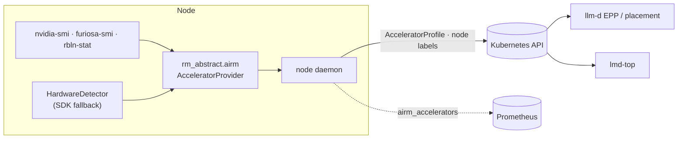

<div align="center">

<h1>rm_abstract_layer</h1>

<h3>Accelerator abstraction for heterogeneous AI infrastructure</h3>

<p>
  <strong>English</strong> · <a href="README.ko.md">한국어</a>
</p>

<p>
  <a href="https://github.com/ai-computing/rm_abstract_layer/actions/workflows/ci.yml"></a>
  <a href="https://github.com/ai-computing/ai-rm"></a>
  <a href="https://github.com/ai-computing/rm-core/blob/v0.1.1/PROTOCOL.md"></a>
  <a href="https://www.python.org/downloads/"></a>
  <a href="LICENSE"></a>
</p>

<p>
  <a href="#-quick-start"><b>Quick start</b></a> ·
  <a href="#-device-discovery-for-ai-rm"><b>ai-rm integration</b></a> ·
  <a href="#-vllm-compatible-api"><b>vLLM-compatible API</b></a> ·
  <a href="#-architecture"><b>Architecture</b></a> ·
  <a href="#-documentation"><b>Docs</b></a>
</p>

</div>

---

**rm_abstract_layer** is the **L1 accelerator abstraction** of [ai-rm](https://github.com/ai-computing/ai-rm). It
discovers GPUs and NPUs (FuriosaAI RNGD, Rebellions ATOM) on each node, describes them through the
[rm-core](https://github.com/ai-computing/rm-core) `Accelerator` model and publishes them to Kubernetes as
`AcceleratorProfile` objects and node labels, which placement (llm-d EPP) and observation (lmd-top) read.

It also provides a **vLLM-compatible Python API** that runs the same code on GPU or CPU with switchable serving
engines (vLLM, Triton, TorchServe).

<table>
<tr>
<td width="33%" valign="top">
<b>🔎 Discover devices</b><br>
Read-only vendor tools first (<code>nvidia-smi</code>, <code>furiosa-smi</code>, <code>rbln-stat</code>), SDK-based
detection as fallback. Device's own index, model, memory and datasheet peak TFLOPS.
</td>
<td width="33%" valign="top">
<b>☸️ Publish to Kubernetes</b><br>
A node daemon (DaemonSet) applies one <code>AcceleratorProfile</code> per device, labels nodes
<code>airm.ai-computing.io/&lt;vendor&gt;.&lt;model&gt;</code> and exports <code>airm_accelerators</code>.
</td>
<td width="33%" valign="top">
<b>🔁 One API, many backends</b><br>
Change <code>from vllm import LLM</code> to <code>from rm_abstract import LLM</code>; pick the device and engine by
argument or environment variable.
</td>
</tr>
</table>

## 🚀 Quick start

```bash
git clone https://github.com/ai-computing/rm_abstract_layer.git && cd rm_abstract_layer
pip install -r requirements/requirements.txt
pip install -e .

python -m rm_abstract.airm.daemon --once --dry-run                  # devices on this node, as k8s objects
python -m rm_abstract.airm.daemon --provider sim --once --dry-run   # same, with simulated devices
python -m rm_core.conformance airm.accelerator_providers rm-abstract  # contract check (PASS / SKIP / FAIL)
```

Installing through ai-rm: `make setup COMPONENTS=rm_abstract_layer` in the
[ai-rm](https://github.com/ai-computing/ai-rm) umbrella (steps come from [`ai-rm.yaml`](ai-rm.yaml)).

## ☸️ Device discovery for ai-rm

### `AcceleratorProvider` adapter

`rm_abstract.airm` implements the rm-core v0.1 `AcceleratorProvider` contract and registers it as
`rm-abstract` in the `airm.accelerator_providers` entry-point group:

```python
from rm_core import registry

provider = registry.load("airm.accelerator_providers", "rm-abstract")
for acc in provider.discover():
    print(acc.id, acc.vendor, acc.model, acc.memory_bytes, acc.peak_tflops)
# node-a/furiosa:0  furiosa  RNGD  ...  {'bf16': 256.0, 'fp8': 512.0}
```

| Field | Value |
|---|---|
| `id` | `<node>/<vendor>:<index>`; index is the device's own number (`npu3` → `furiosa:3`) |
| node name | `AIRM_NODE_NAME` (set from `spec.nodeName` in the DaemonSet), else the hostname |
| `peak_tflops` | Only where the vendor datasheet states it (RNGD, ATOM), with `peak_source`; unknown otherwise |
| CPUs | Not reported; a node without accelerators yields `[]` |

### Node daemon

`python -m rm_abstract.airm.daemon` discovers periodically and

- applies one `AcceleratorProfile` (`airm.ai-computing.io/v1alpha1`) per device, deleting profiles of devices that
  stayed missing for `AIRM_REMOVE_AFTER` consecutive rounds,
- patches node labels `airm.ai-computing.io/<vendor>.<model>=<count>` and `airm.ai-computing.io/managed=true`,
- serves `airm_accelerators{vendor,model}` on `/metrics`.

| Variable | Default | Meaning |
|---|---|---|
| `AIRM_NODE_NAME` | hostname | Node name used in ids and labels |
| `AIRM_PROVIDER` | `rm-abstract` | Provider entry point (`sim` for a demo) |
| `AIRM_INTERVAL_S` | `60` | Discovery interval |
| `AIRM_METRICS_PORT` | `9400` | `/metrics` port, `0` disables |
| `AIRM_REMOVE_AFTER` | `3` | Missed rounds before a profile is deleted (avoids flapping on a transient tool failure) |

Applying to a cluster needs the Kubernetes client: `pip install -e ".[k8s]"`.

### Helm chart

[`deploy/helm/rm-abstract-node`](deploy/helm/rm-abstract-node) installs the daemon as a DaemonSet with a
ServiceAccount and ClusterRole (`acceleratorprofiles` CRUD, `nodes` get/patch). The `AcceleratorProfile` CRD
ships with [rm-core](https://github.com/ai-computing/rm-core/tree/v0.1.1/k8s) and is installed by llm-d-setup / the
ai-rm umbrella. Set the image for your site with `image.repository` / `image.tag`.

```bash
helm template rm-abstract-node deploy/helm/rm-abstract-node --set image.repository=<registry>/rm-abstract-node
```

## 🔁 vLLM-compatible API

```python
# from vllm import LLM, SamplingParams
from rm_abstract import LLM, SamplingParams

llm = LLM(model="gpt2")                                  # auto: GPU > CPU
llm = LLM(model="gpt2", device="cpu")                    # or RM_DEVICE=cpu
llm = LLM(model="gpt2", engine="triton")                 # or RM_ENGINE=triton
outputs = llm.generate(["Hello, I am"], SamplingParams(max_tokens=50))
print(outputs[0].outputs[0].text)
```

<details>
<summary><b>Runtime control, engines and errors</b></summary>
<br>

```python
import rm_abstract

rm_abstract.init(device="auto")
print(rm_abstract.get_available_resources())   # {'nvidia': True, 'cpu': True}
rm_abstract.switch_device("cpu")
```

| Engine | Managed for you |
|---|---|
| vLLM (default) | — |
| Triton | HuggingFace → ONNX conversion, model repository, Docker container start/stop |
| TorchServe | MAR packaging, server start, model registration, cleanup |

```python
from rm_abstract.exceptions import BackendNotAvailableError

try:
    llm = LLM(model="gpt2", device="nvidia")
except BackendNotAvailableError:
    llm = LLM(model="gpt2", device="cpu")
```

Installation extras: `.[gpu]`, `.[triton]`, `.[torchserve]`, `.[serving]`, `.[all]` (see
[requirements guide](docs/README_REQUIREMENTS.md)). More in [quick start](docs/QUICKSTART.md) and
[serving engines](docs/SERVING_ENGINES.md).
</details>

### Support matrix

| Device | Discovery & `AcceleratorProfile` | Inference through `LLM` |
|---|:-:|:-:|
| NVIDIA GPU | ✅ | ✅ vLLM · Triton · TorchServe |
| CPU | — *(not reported as an accelerator)* | ✅ transformers · TorchServe |
| FuriosaAI RNGD | ✅ | 🧪 plugin present, not validated |
| Rebellions ATOM | ✅ | 🧪 plugin present, not validated |

## 🏗 Architecture



```text
src/rm_abstract/
├── airm/          # ai-rm protocol v0.1: AcceleratorProvider, node daemon
├── resources/     # device plugins: gpu/nvidia, npu/furiosa, npu/rebellions, cpu
├── engines/       # serving engines: vLLM, Triton, TorchServe, model conversion
├── common/        # hardware detection, input/output adapters
├── compat/        # vLLM / transformers compatibility layers
├── registry/      # plugin registry and discovery
├── core/          # configuration, DeviceFlowController
└── llm.py         # vLLM-compatible LLM proxy
```

## 🧪 Development

```bash
pip install -e ".[dev]"
pytest -m "not gpu and not slow" tests/unit     # quick tests, no accelerator needed
ruff check src tests && black --check src tests
python tools/check_sensitive.py .               # internal addresses, tokens, keys
bash scripts/run_examples.sh                    # run every example (needs models / devices)
```

Guides: [contributing](docs/CONTRIBUTING.md) · [adding a device](docs/ADDING_RESOURCES.md) ·
[adding an engine](docs/ADDING_ENGINES.md).

## 🗺 Roadmap

- [x] rm-core v0.1 `AcceleratorProvider`, node daemon, Helm chart
- [ ] Published `rm-abstract-node` container image
- [ ] Validated RNGD / ATOM inference through the `LLM` API
- [ ] Engine-facing backend adapters for Optimus Prime (see the ai-rm [engine plan](https://github.com/ai-computing/ai-rm/blob/master/docs/engine-integration.md))
- [ ] Wider device model: partitions, interconnect topology, live utilization

## 📚 Documentation

| | |
|---|---|
| **Use** | [Quick start](docs/QUICKSTART.md) · [Serving engines](docs/SERVING_ENGINES.md) · [Requirements](docs/README_REQUIREMENTS.md) |
| **Understand** | [Architecture](docs/ARCHITECTURE.md) · [Project structure](docs/PROJECT_STRUCTURE.md) · [Changelog](CHANGELOG.md) |
| **Extend** | [Contributing](docs/CONTRIBUTING.md) · [Adding resources](docs/ADDING_RESOURCES.md) · [Adding engines](docs/ADDING_ENGINES.md) |
| **ai-rm** | [Umbrella](https://github.com/ai-computing/ai-rm) · [rm-core protocol](https://github.com/ai-computing/rm-core/blob/v0.1.1/PROTOCOL.md) · [Component card](https://github.com/ai-computing/ai-rm/blob/master/docs/components/rm_abstract_layer.md) |

Older test reports and slides: [docs/archive](docs/archive/README.md).

## 📄 License

BSD-3-Clause. NPU backends need the vendors' own SDKs (Rebellions RBLN SDK, FuriosaAI SDK) under their
license terms; this project does not redistribute them.

<details>
<summary><b>Third-party licenses</b></summary>
<br>

| Package | License |
|---|---|
| [PyTorch](https://github.com/pytorch/pytorch) | BSD-3-Clause |
| [vLLM](https://github.com/vllm-project/vllm) | Apache-2.0 |
| [Triton Inference Server](https://github.com/triton-inference-server/server) | BSD-3-Clause |
| [TorchServe](https://github.com/pytorch/serve) | Apache-2.0 |
| [HuggingFace Transformers](https://github.com/huggingface/transformers) | Apache-2.0 |
| [vllm-rbln](https://github.com/rebellions-sw/vllm-rbln) · [optimum-rbln](https://github.com/rebellions-sw/optimum-rbln) | Apache-2.0 |
| [FuriosaAI SDK](https://github.com/furiosa-ai/furiosa-sdk) | Apache-2.0 |

| NPU | SDK | License | Access |
|---|---|---|---|
| Rebellions ATOM | RBLN SDK (compiler, driver, runtime) | Proprietary | [Request access](https://rebellions.ai/request-form-rbln-sdk/) |
| FuriosaAI RNGD | FuriosaAI SDK (driver, firmware, runtime) | Proprietary (EULA) | [furiosa.ai](https://furiosa.ai/) |
</details>

<div align="center"><sub>Part of <a href="https://github.com/ai-computing/ai-rm">ai-rm</a> · ai-computing team · ETRI</sub></div>
